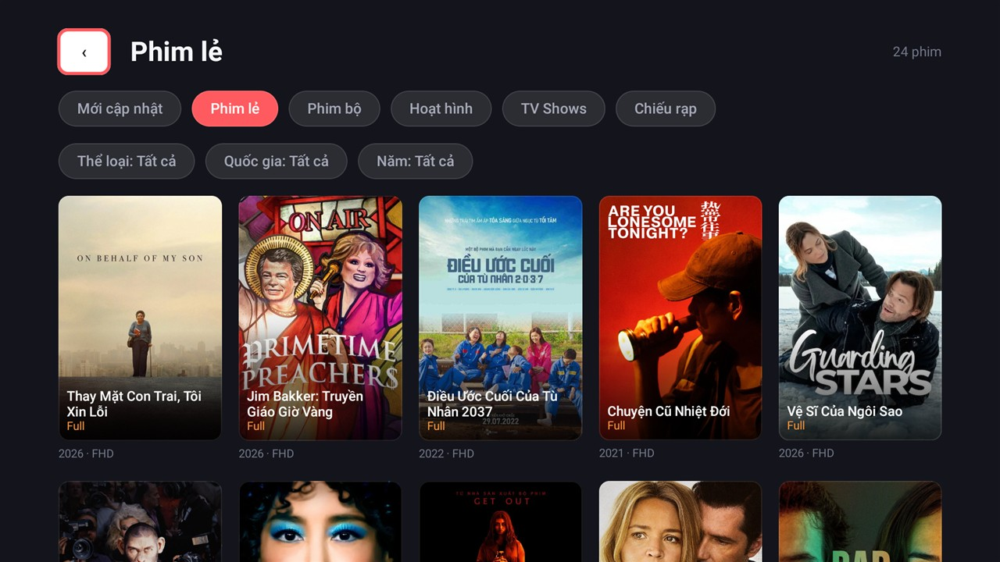
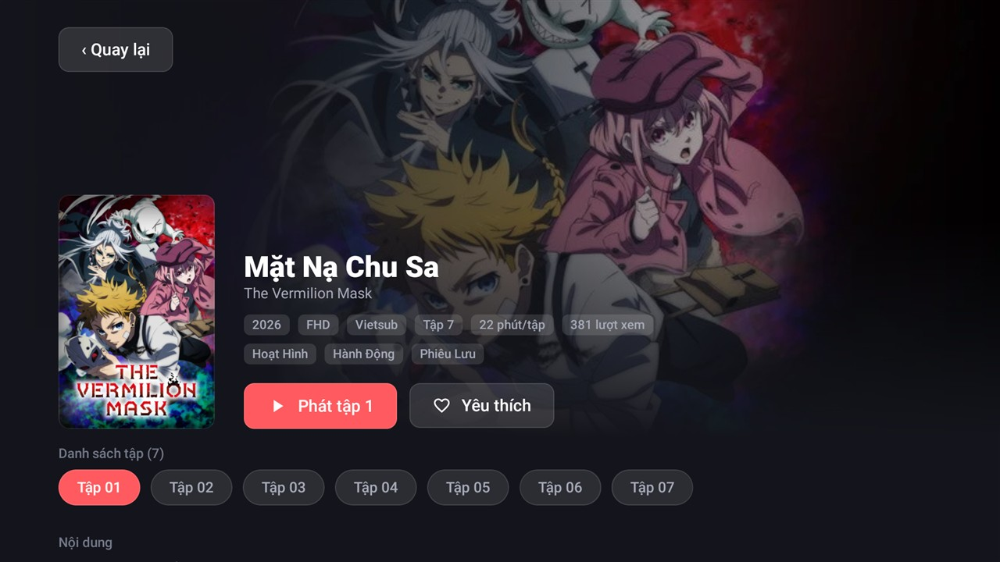
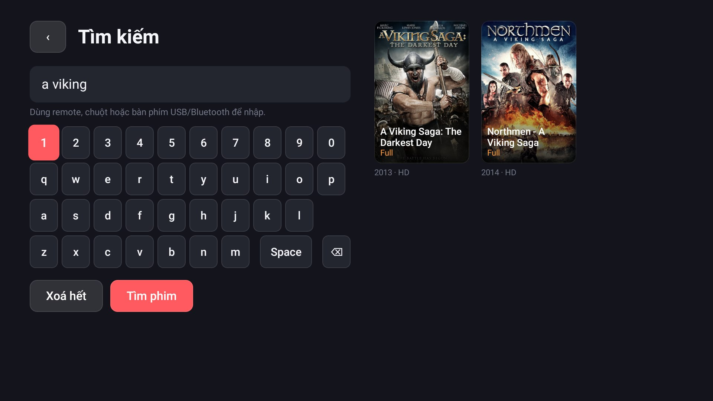

# AuraFlix TV

Ứng dụng xem phim **dành riêng cho Android TV / TV Box** (Amlogic S905X2, Xiaomi Box, Google TV…),
giao diện điều khiển hoàn toàn bằng remote.

> 📱 **Bản Mobile (điện thoại cảm ứng):** dùng chung tầng dữ liệu, APK riêng
> `com.auraflix.mobile` — xem [`docs/MOBILE.md`](docs/MOBILE.md).
> Build: `./gradlew :mobile:assembleRelease`.

> 📺 **Điều khiển TV bằng điện thoại (cùng Wi-Fi):** ghép cặp bằng PIN, chọn phim và điều khiển
> phát/tạm dừng/tua trên điện thoại — xem [`docs/CAST.md`](docs/CAST.md).

> Nội dung lấy từ API công khai mà website `auraflix.vip` đang sử dụng (`phimapi.com`).
> Ứng dụng không lưu trữ hay phát tán phim; toàn bộ bản quyền thuộc về đơn vị cung cấp gốc.

> 📖 **Tài liệu chi tiết:** [Hướng dẫn tính năng đầy đủ](docs/FEATURES.md) — điều khiển remote,
> tua nhanh khi giữ nút, tìm kiếm, OTA, xử lý sự cố và lịch sử phiên bản.

## 0. Ảnh chụp từ TV box (Amlogic S905X2 · 1080p · Android 9)

| Trang chủ | Danh mục |
|---|---|
|  |  |

| Chi tiết phim | Trình phát |
|---|---|
|  |  |

| Tìm kiếm | Cài đặt |
|---|---|
|  |  |

## Tải APK

| Phiên bản | Tệp | Dung lượng | SHA-256 |
|---|---|---|---|
| 1.2.0 | [`AuraFlixTV-1.2.0.apk`](AuraFlixTV-1.2.0.apk) | 3.07 MB | `29C69408C117D4A90CC5557238CE74B3D32F1441515ED5E600F93C8EB9F0022A` |
| 1.1.3 | [`AuraFlixTV-1.1.3.apk`](AuraFlixTV-1.1.3.apk) | 3.04 MB | `EDCCE6C960BA70475F45B2236A65B384559EE6E0EC31A5C8CD3A71275054C83F` |
| 1.1.2 | [`AuraFlixTV-1.1.2.apk`](AuraFlixTV-1.1.2.apk) | 3.04 MB | `62DAE787935D7E62FFA7CBABECAD40C3BF474AF319DD0915BA0B32BE6F8D3409` |
| 1.1.1 | [`AuraFlixTV-1.1.1.apk`](AuraFlixTV-1.1.1.apk) | 3.04 MB | `426BE35AC4BC8C9025F9EE4A2A4B0DCA93A08BDAB13D240C5BA8A59D77A5E52C` |
| 1.1.0 | [`AuraFlixTV-1.1.0.apk`](AuraFlixTV-1.1.0.apk) | 3.04 MB | `D7AEE06A12CA30D92D09949F4395FFB70CD2DEA8E19F0A9C66283A3CD056C9D4` |
| 1.0.0 | [`AuraFlixTV-1.0.0.apk`](AuraFlixTV-1.0.0.apk) | 3.02 MB | `CCECF9D51AA87D0A9D43065958E364D83E5C769D598C4828C0BCBF9A5DFC02AB` |

Bản phát hành kèm APK cũng nằm ở tab **Releases**:
<https://github.com/haokiet97/auraflix_tv_release/releases>

**Trang tải nhanh (GitHub Pages):** <https://haokiet97.github.io/auraflix_tv_release/>

**Link rút gọn luôn tải bản mới nhất (Downloader):** `is.gd/auraflixtv2` (dự phòng: `tinyurl.com/auraflixtv2`)

> Link cũ `is.gd/auraflixtv` vẫn trỏ tới bản 1.0.0; hãy dùng link mới để nhận v1.1.0.

Kiểm tra file sau khi tải (Windows PowerShell):

```powershell
Get-FileHash .\AuraFlixTV-1.2.0.apk -Algorithm SHA256
```

## Tải APK Mobile (điện thoại)

| Phiên bản | Tệp | Dung lượng | SHA-256 |
|---|---|---|---|
| 1.1.0 | [`AuraFlixMobile-1.1.0.apk`](https://github.com/haokiet97/auraflix_mobile_release/releases/download/v1.1.0/AuraFlixMobile-1.1.0.apk) | 3.13 MB | `4E86D2279A36CC32F09A4D0C87C99F60F6D161519505308C457F6B63399EB025` |
| 1.0.3 | [`AuraFlixMobile-1.0.3.apk`](https://github.com/haokiet97/auraflix_mobile_release/releases/download/v1.0.3/AuraFlixMobile-1.0.3.apk) | 3.07 MB | `F43903BAE6F95192721F4429461D70882CBDB0ECCC65B714B8AB5ECDAF88010C` |
| 1.0.2 | [`AuraFlixMobile-1.0.2.apk`](https://github.com/haokiet97/auraflix_mobile_release/releases/download/v1.0.2/AuraFlixMobile-1.0.2.apk) | 3.07 MB | `733EAADF72E2B497701440C275330149CBD9DFC03E5A0D0131723252505257D9` |
| 1.0.1 | [`AuraFlixMobile-1.0.1.apk`](https://github.com/haokiet97/auraflix_mobile_release/releases/download/v1.0.1/AuraFlixMobile-1.0.1.apk) | 3.07 MB | `F52A319E6AA91E7151A04B1D32F1E184561BD98D21188B6A4CFE9515BCB8BD06` |
| 1.0.0 | [`AuraFlixMobile-1.0.0.apk`](https://github.com/haokiet97/auraflix_mobile_release/releases/download/v1.0.0/AuraFlixMobile-1.0.0.apk) | 3.07 MB | `05933F834AD47BDC2BEA10AE94B9BD930C3A8E9D319CECA88194B73FE3565BDD` |

- Trang giới thiệu & tải nhanh: <https://haokiet97.github.io/auraflix_mobile_release/>
- Trang phát hành: <https://github.com/haokiet97/auraflix_mobile_release/releases/latest>
- Hướng dẫn & ảnh chụp: [`docs/MOBILE.md`](docs/MOBILE.md)
- Quy trình phát hành: [`docs/RELEASE_GUIDE_MOBILE.md`](docs/RELEASE_GUIDE_MOBILE.md)

---

## 1. Tính năng

| Nhóm | Chi tiết |
|---|---|
| Trang chủ | Banner phim mới tự luân chuyển, các hàng: Xem tiếp, Phim mới, Phim lẻ, Phim bộ, Hoạt hình, TV Shows, Chiếu rạp |
| Danh mục | Lọc kết hợp **Loại + Thể loại + Quốc gia + Năm**, cuộn vô hạn |
| Tìm kiếm | Bàn phím ảo có **phím Space** ở hàng cuối, hỗ trợ **bàn phím USB/Bluetooth**, **chuột/chuột bay**; tìm ngay khi ngừng gõ (debounce 400ms) |
| Chi tiết | Poster, backdrop, thông tin, mô tả, chọn nguồn phát, chọn tập, phim liên quan, yêu thích |
| Trình phát | ExoPlayer (Media3) + HLS, tự chọn chất lượng, resume, chuyển tập, đổi nguồn khi lỗi |
| Tua nhanh | Nhấn ◀/▶ tua ±10s; **giữ ◀/▶** tua tăng dần 10→60 giây/bước, có OSD tổng thời lượng |
| Điều khiển | ◀ ▶ tua ±10s và hiện OSD; OK/▲/▼ hiện thanh công cụ; OK chọn nút đang focus; Back thoát; chuột bấm/rê để focus |
| Cập nhật | **OTA trong Cài đặt**: kiểm tra bản mới, xem ghi chú, tải có tiến độ, xác thực SHA-256 và cài đè giữ dữ liệu |
| Điều khiển bằng điện thoại | TV mở HTTP server trong LAN + mã PIN; điện thoại cùng Wi-Fi tự tìm thấy TV, chọn phim và phát trên TV, tua, chuyển tập ([chi tiết](docs/CAST.md)) |
| Tiện ích | Lịch sử xem, xem tiếp, yêu thích, phóng to khung hình, tốc độ phát, cài đặt máy chủ API |

## 2. Yêu cầu

- TV Box / Android TV chạy **Android 5.0 (API 21)** trở lên (đã tối ưu cho Android 9 trên S905X2).
- Kết nối Internet.
- Không cần Google Play Services, không cần root.

## 3. Cài đặt lên TV Box

### Cách 1 — qua ADB (nhanh nhất)

```bash
# Bật "USB debugging"/"Network debugging" trên box, biết IP box
adb connect 192.168.1.x:5555
adb install -r app-release.apk
```

Sau đó mở app **AuraFlix** trong hàng ứng dụng của Android TV.

### Cách 2 — qua USB

1. Copy `app-release.apk` vào USB, cắm vào box.
2. Dùng ứng dụng quản lý file trên box (hoặc Downloader) để cài.
3. Nếu bị chặn: bật *Cài đặt → Bảo mật → Nguồn không xác định*.

### Cách 3 — qua Downloader

Tải APK lên Google Drive/OneDrive rồi nhập link bằng app **Downloader** trên box.

### Cập nhật từ bản cũ (OTA)

> **Lưu ý:** v1.0.0 chưa có tính năng OTA. Nếu đang dùng v1.0.0, hãy cài đè v1.1.0 **một lần**
> bằng ADB/USB/Downloader. Từ v1.1.0 trở đi, các bản sau cập nhật trực tiếp trong Cài đặt.

1. Mở **Cài đặt → Cập nhật ứng dụng** (app tự kiểm tra khi mở; có thể bấm **Kiểm tra cập nhật**).
2. Khi có bản mới, bấm **Cập nhật ngay** và theo dõi thanh tiến độ.
3. Tải xong, bấm **Cài đặt ngay** và xác nhận trên hộp thoại của Android.
4. Nếu box chưa cho phép, bật *Cài đặt ứng dụng không rõ nguồn gốc* cho AuraFlix rồi bấm lại.

APK được tải trực tiếp trong app và đối chiếu **SHA-256** với GitHub trước khi cài.
Bản mới dùng cùng khoá ký nên nâng cấp tại chỗ, **giữ nguyên** lịch sử xem, yêu thích và cài đặt.

## 4. Build từ source

```bash
# Yêu cầu: JDK 17, Android SDK (platform 35, build-tools 35.0.0)
# Tạo local.properties: sdk.dir=C:\\Users\\<you>\\AppData\\Local\\Android\\Sdk

./gradlew :app:assembleRelease       # APK TV ~3 MB
./gradlew :mobile:assembleRelease    # APK Mobile ~3.1 MB
./gradlew :app:testDebugUnitTest     # 19 unit test: parse JSON, phiên bản, release notes, giao thức cast
```

APK ra ở `app/build/outputs/apk/release/app-release.apk` (~3 MB)
và `mobile/build/outputs/apk/release/mobile-release.apk` (bản điện thoại).

Cấu trúc module: `:shared` (dữ liệu + ViewModel dùng chung), `:app` (UI TV), `:mobile` (UI cảm ứng).


Bản release hiện ký bằng debug keystore để tiện cài trực tiếp. Nếu phát hành chính thức,
tạo keystore riêng và cấu hình `signingConfigs` trong `app/build.gradle.kts`.

### Kiểm thử đã chạy

| Hạng mục | Kết quả |
|---|---|
| `assembleDebug` / `assembleRelease` | ✅ thành công, không lỗi biên dịch |
| Unit test parse JSON + phiên bản + release notes + giao thức cast | ✅ 19/19 pass |
| `aapt2 dump badging` | ✅ có `leanback-launchable-activity`, banner 320×180, minSdk 21, targetSdk 34 |
| Kích thước APK release | 3.07 MB (v1.2.0) |
| **Chạy thật trên box N5Max (S905X2, Android 9, 1920×1080@320dpi)** | ✅ xem phim 1080p bằng giải mã cứng `OMX.amlogic.avc.decoder` |
| Tìm kiếm trên box | ✅ phím **Space** ở hàng cuối, gõ bàn phím, bấm chuột chèn khoảng trắng và mở phim |
| Điều khiển trình phát trên box | ✅ OK/▲/▼ hiện thanh công cụ; ◀/▶ nhấn tua ±10s, **giữ để tua tăng dần** kèm OSD |
| Kiểm tra cập nhật trên box | ✅ báo đúng "Bạn đang dùng bản mới nhất (v1.1.3)" |
| Crash / ANR sau toàn bộ luồng test | ✅ không có trong logcat |
| Bộ nhớ khi đang phát phim | Java heap ~6 MB, Native ~10 MB |

Luồng đã kiểm thử trên thiết bị: trang chủ → chi tiết → phát tập → thanh điều khiển → danh sách tập →
đổi server → thoát và **Xem tiếp** đúng vị trí → danh mục + lọc thể loại → tìm kiếm bằng bàn phím ảo → cài đặt.

## 5. Kiến trúc

```
com.auraflix.tv
├── AuraFlixApp.kt          # Application + ServiceLocator (Graph)
├── MainActivity.kt         # 1 activity duy nhất
├── core/
│   ├── model/              # DTO khớp JSON của phimapi.com
│   ├── net/                # OkHttp + kotlinx.serialization (cache 128MB)
│   ├── repo/               # MovieRepository, UserDataRepository (DataStore)
│   ├── update/             # AppVersion (so sánh phiên bản), UpdateManager (OTA)
│   ├── cast/               # Điều khiển TV ↔ Mobile trong LAN: server + discovery, client, giao thức
│   └── util/               # format thời gian, text
├── ui/
│   ├── theme/              # màu, MaterialTheme cho TV
│   ├── components/         # TvFocusable, PosterCard, TvButton, FilterChip…
│   ├── home/ browse/ search/ detail/ player/ favorites/ settings/
│   └── nav/                # Navigation Compose
└── player (Media3)         # ExoPlayer + HLS + OkHttp DataSource
```

- **Không dùng DI framework** (Hilt/KSP) → build nhanh, APK nhỏ.
- **Không dùng Leanback library**: Compose for TV với `Modifier` focus tự viết để
  kiểm soát hoàn toàn hành vi D-pad trên các box Trung Quốc/Amlogic.
- **Cache**: OkHttp 128MB + cache RAM 5 phút cho danh sách, 15 phút cho chi tiết.
- **Điều khiển từ điện thoại**: HTTP server + UDP discovery viết tay trong `:shared/core/cast`
  (không cần Kotlin/NanoHTTPD), chạy trong thread nền của Application.
- `minSdk 21`, `targetSdk 34`, `compileSdk 35`.

## 6. Nguồn dữ liệu (API)

| Chức năng | Endpoint |
|---|---|
| Phim mới | `GET https://phimapi.com/v1/api/danh-sach/phim-moi-cap-nhat?page=1` |
| Danh sách + lọc | `GET /v1/api/danh-sach/{type}?page=&category=&country=&year=` |
| Thể loại | `GET /v1/api/the-loai` |
| Quốc gia | `GET /v1/api/quoc-gia` |
| Tìm kiếm | `GET /v1/api/tim-kiem?keyword=&page=` |
| Chi tiết + tập | `GET /phim/{slug}` → `episodes[].server_data[].link_m3u8` |

Nếu domain API thay đổi, vào **Cài đặt → Máy chủ dữ liệu phim** để chọn domain khác.

## 7. Xử lý sự cố

| Hiện tượng | Cách xử lý |
|---|---|
| Trang chủ báo lỗi mạng | Kiểm tra Internet; thử đổi *Máy chủ dữ liệu phim* trong Cài đặt |
| Poster trắng | CDN ảnh đổi domain → app tự đọc `APP_DOMAIN_CDN_IMAGE`, thử tải lại |
| Video không phát | Bấm **Đổi nguồn phát** (nếu phim có nhiều server); nếu vẫn lỗi, nguồn phim gốc đang chết |
| Cập nhật báo lỗi mạng | Kiểm tra Internet rồi bấm **Kiểm tra cập nhật** lại; box cần truy cập được `api.github.com` |
| Bấm Cài đặt ngay nhưng không hiện hộp thoại | Bật *Cài đặt ứng dụng không rõ nguồn gốc* cho AuraFlix trong phần Cài đặt Android, rồi bấm lại |
| Remote không di chuyển | Đảm bảo dùng remote/chuột bay ở chế độ D-pad, không phải chế độ chuột |
| Điện thoại không tìm thấy TV | Mục *Cài đặt → Điều khiển bằng điện thoại* phải đang **Bật**; hai máy chung Wi-Fi; router chặn broadcast → nhập tay IP TV ([chi tiết](docs/CAST.md)) |
| App không hiện trên launcher | Box không chuẩn Android TV → mở bằng mục *Ứng dụng* hoặc qua ADB (`am start`) |

## 8. Giấy phép

Phát hành theo **Apache License 2.0** — xem [LICENSE](LICENSE).

Ứng dụng không sở hữu nội dung phim; vui lòng chỉ dùng cho mục đích cá nhân.

