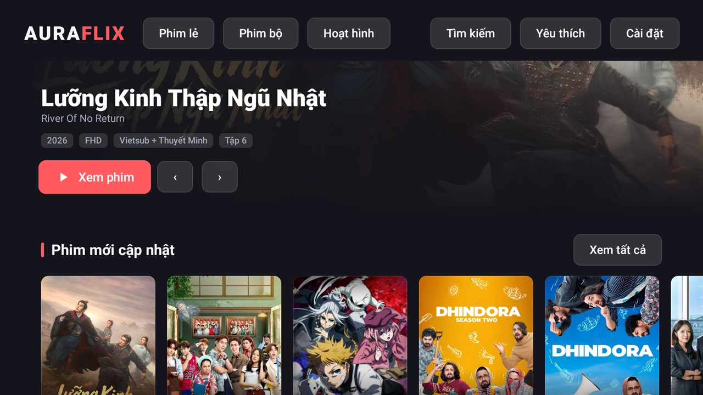
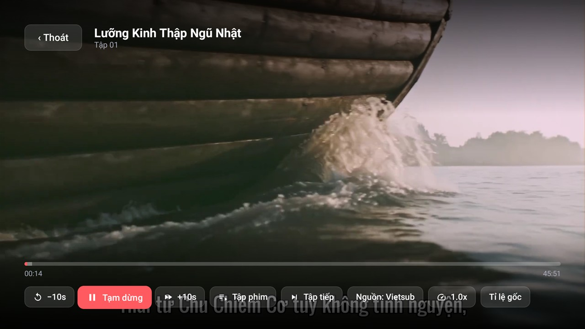
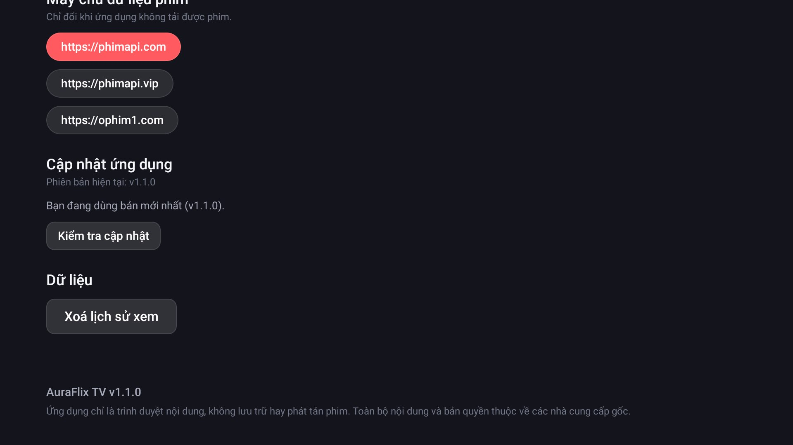

# AuraFlix TV

Ứng dụng xem phim **dành riêng cho Android TV / TV Box** (Amlogic S905X2, Xiaomi Box, Google TV…),
giao diện điều khiển hoàn toàn bằng remote.

> Nội dung lấy từ API công khai mà website `auraflix.vip` đang sử dụng (`phimapi.com`).
> Ứng dụng không lưu trữ hay phát tán phim; toàn bộ bản quyền thuộc về đơn vị cung cấp gốc.

## 0. Ảnh chụp từ TV box (Amlogic S905X2 · 1080p · Android 9)

| Trang chủ | Danh mục |
|---|---|
|  |  |

| Chi tiết phim | Trình phát |
|---|---|
|  |  |

| Tìm kiếm | Cài đặt |
|---|---|
|  |  |

## Tải APK

| Phiên bản | Tệp | Dung lượng | SHA-256 |
|---|---|---|---|
| 1.0.0 | [`AuraFlixTV-1.0.0.apk`](AuraFlixTV-1.0.0.apk) | 3.02 MB | `CCECF9D51AA87D0A9D43065958E364D83E5C769D598C4828C0BCBF9A5DFC02AB` |

Bản phát hành kèm APK cũng nằm ở tab **Releases**:
<https://github.com/haokiet97/auraflix_tv_release/releases>

**Trang tải nhanh (GitHub Pages):** <https://haokiet97.github.io/auraflix_tv_release/>

**Link rút gọn để gõ trên remote (Downloader):** `is.gd/auraflixtv` (dự phòng: `tinyurl.com/auraflixtv`)

Kiểm tra file sau khi tải (Windows PowerShell):

```powershell
Get-FileHash .\AuraFlixTV-1.0.0.apk -Algorithm SHA256
```

---

## 1. Tính năng

| Nhóm | Chi tiết |
|---|---|
| Trang chủ | Banner phim mới tự luân chuyển, các hàng: Xem tiếp, Phim mới, Phim lẻ, Phim bộ, Hoạt hình, TV Shows, Chiếu rạp |
| Danh mục | Lọc kết hợp **Loại + Thể loại + Quốc gia + Năm**, cuộn vô hạn |
| Tìm kiếm | Bàn phím ảo tối ưu remote, tìm ngay khi ngừng gõ (debounce 400ms) |
| Chi tiết | Poster, backdrop, thông tin, mô tả, chọn nguồn phát, chọn tập, phim liên quan, yêu thích |
| Trình phát | ExoPlayer (Media3) + HLS, tự chọn chất lượng, resume, chuyển tập, đổi nguồn khi lỗi |
| Điều khiển | ◀ ▶ tua ±10s, OK play/pause, ▲▼ hiện thanh điều khiển, Back thoát |
| Tiện ích | Lịch sử xem, xem tiếp, yêu thích, phóng to khung hình, tốc độ phát, cài đặt máy chủ API |

## 2. Yêu cầu

- TV Box / Android TV chạy **Android 5.0 (API 21)** trở lên (đã tối ưu cho Android 9 trên S905X2).
- Kết nối Internet.
- Không cần Google Play Services, không cần root.

## 3. Cài đặt lên TV Box

### Cách 1 — qua ADB (nhanh nhất)

```bash
# Bật "USB debugging"/"Network debugging" trên box, biết IP box
adb connect 192.168.1.x:5555
adb install -r app-release.apk
```

Sau đó mở app **AuraFlix** trong hàng ứng dụng của Android TV.

### Cách 2 — qua USB

1. Copy `app-release.apk` vào USB, cắm vào box.
2. Dùng ứng dụng quản lý file trên box (hoặc Downloader) để cài.
3. Nếu bị chặn: bật *Cài đặt → Bảo mật → Nguồn không xác định*.

### Cách 3 — qua Downloader

Tải APK lên Google Drive/OneDrive rồi nhập link bằng app **Downloader** trên box.

## 4. Build từ source

```bash
# Yêu cầu: JDK 17, Android SDK (platform 35, build-tools 35.0.0)
# Tạo local.properties: sdk.dir=C:\\Users\\<you>\\AppData\\Local\\Android\\Sdk

./gradlew :app:assembleRelease   # APK ~3 MB
./gradlew :app:testDebugUnitTest # 5 unit test cho tầng parse JSON
```

APK ra ở `app/build/outputs/apk/release/app-release.apk` (~3 MB).

Bản release hiện ký bằng debug keystore để tiện cài trực tiếp. Nếu phát hành chính thức,
tạo keystore riêng và cấu hình `signingConfigs` trong `app/build.gradle.kts`.

### Kiểm thử đã chạy

| Hạng mục | Kết quả |
|---|---|
| `assembleDebug` / `assembleRelease` | ✅ thành công, không lỗi biên dịch |
| Unit test parse JSON (list / detail / taxonomy / unknown field / UTF-8) | ✅ 5/5 pass |
| `aapt2 dump badging` | ✅ có `leanback-launchable-activity`, banner 320×180, minSdk 21, targetSdk 34 |
| Kích thước APK release | 3.02 MB |
| **Chạy thật trên box N5Max (S905X2, Android 9, 1920×1080@320dpi)** | ✅ xem phim 1080p bằng giải mã cứng `OMX.amlogic.avc.decoder` |
| Crash / ANR sau toàn bộ luồng test | ✅ không có trong logcat |
| Bộ nhớ khi đang phát phim | Java heap ~6 MB, Native ~10 MB |

Luồng đã kiểm thử trên thiết bị: trang chủ → chi tiết → phát tập → thanh điều khiển → danh sách tập →
đổi server → thoát và **Xem tiếp** đúng vị trí → danh mục + lọc thể loại → tìm kiếm bằng bàn phím ảo → cài đặt.

## 5. Kiến trúc

```
com.auraflix.tv
├── AuraFlixApp.kt          # Application + ServiceLocator (Graph)
├── MainActivity.kt         # 1 activity duy nhất
├── core/
│   ├── model/              # DTO khớp JSON của phimapi.com
│   ├── net/                # OkHttp + kotlinx.serialization (cache 128MB)
│   ├── repo/               # MovieRepository, UserDataRepository (DataStore)
│   └── util/               # format thời gian, text
├── ui/
│   ├── theme/              # màu, MaterialTheme cho TV
│   ├── components/         # TvFocusable, PosterCard, TvButton, FilterChip…
│   ├── home/ browse/ search/ detail/ player/ favorites/ settings/
│   └── nav/                # Navigation Compose
└── player (Media3)         # ExoPlayer + HLS + OkHttp DataSource
```

- **Không dùng DI framework** (Hilt/KSP) → build nhanh, APK nhỏ.
- **Không dùng Leanback library**: Compose for TV với `Modifier` focus tự viết để
  kiểm soát hoàn toàn hành vi D-pad trên các box Trung Quốc/Amlogic.
- **Cache**: OkHttp 128MB + cache RAM 5 phút cho danh sách, 15 phút cho chi tiết.
- `minSdk 21`, `targetSdk 34`, `compileSdk 35`.

## 6. Nguồn dữ liệu (API)

| Chức năng | Endpoint |
|---|---|
| Phim mới | `GET https://phimapi.com/v1/api/danh-sach/phim-moi-cap-nhat?page=1` |
| Danh sách + lọc | `GET /v1/api/danh-sach/{type}?page=&category=&country=&year=` |
| Thể loại | `GET /v1/api/the-loai` |
| Quốc gia | `GET /v1/api/quoc-gia` |
| Tìm kiếm | `GET /v1/api/tim-kiem?keyword=&page=` |
| Chi tiết + tập | `GET /phim/{slug}` → `episodes[].server_data[].link_m3u8` |

Nếu domain API thay đổi, vào **Cài đặt → Máy chủ dữ liệu phim** để chọn domain khác.

## 7. Xử lý sự cố

| Hiện tượng | Cách xử lý |
|---|---|
| Trang chủ báo lỗi mạng | Kiểm tra Internet; thử đổi *Máy chủ dữ liệu phim* trong Cài đặt |
| Poster trắng | CDN ảnh đổi domain → app tự đọc `APP_DOMAIN_CDN_IMAGE`, thử tải lại |
| Video không phát | Bấm **Đổi nguồn phát** (nếu phim có nhiều server); nếu vẫn lỗi, nguồn phim gốc đang chết |
| Remote không di chuyển | Đảm bảo dùng remote/chuột bay ở chế độ D-pad, không phải chế độ chuột |
| App không hiện trên launcher | Box không chuẩn Android TV → mở bằng mục *Ứng dụng* hoặc qua ADB (`am start`) |

## 8. Giấy phép

Phát hành theo **Apache License 2.0** — xem [LICENSE](LICENSE).

Ứng dụng không sở hữu nội dung phim; vui lòng chỉ dùng cho mục đích cá nhân.

