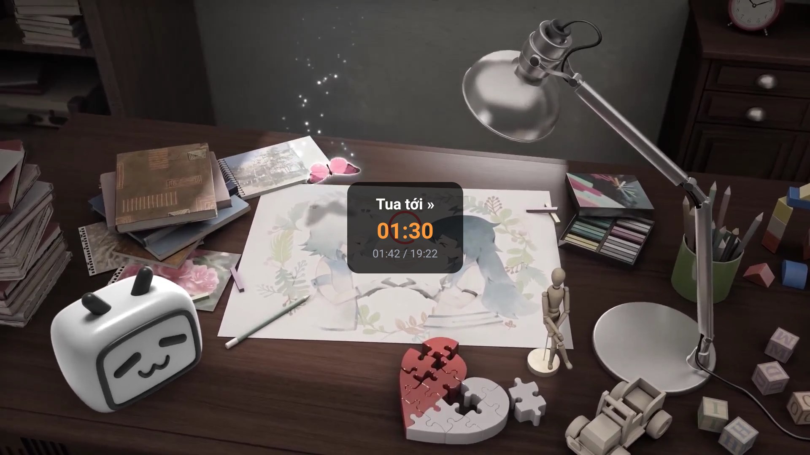

# AuraFlix TV — Hướng dẫn tính năng chi tiết

> Phiên bản tài liệu: **1.1.3** (versionCode 5)
> Nền tảng: Android TV / Google TV / TV Box · Android 5.0 (API 21) trở lên
> Đã kiểm thử: N5Max · Amlogic S905X2 · Android 9 · 1920×1080 · remote + chuột + bàn phím USB

AuraFlix TV là ứng dụng xem phim tối ưu cho TV, điều khiển hoàn toàn bằng remote.
Nội dung lấy từ API công khai `phimapi.com` (nguồn mà website `auraflix.vip` đang dùng).
Ứng dụng không lưu trữ hay phát tán phim; bản quyền thuộc về nhà cung cấp gốc.

---

## 1. Nguyên tắc thiết kế

- **Remote là chính**: mọi thành phần đều focus được bằng D-pad, có viền/scale rõ ràng.
- **Không phụ thuộc Google Play Services**, không cần root, không cần tài khoản.
- **Nhẹ**: APK ~3 MB, không dùng DI framework, cache thông minh.
- **Ảnh và dữ liệu được cache** để cuộn mượt trên box cấu hình thấp.
- **Nâng cấp tại chỗ**: OTA giữ nguyên lịch sử xem, yêu thích và cài đặt.

---

## 2. Cài đặt & yêu cầu

| Hạng mục | Yêu cầu |
|---|---|
| Hệ điều hành | Android 5.0 (API 21) trở lên |
| Bộ nhớ | Khuyến nghị 2 GB RAM trở lên |
| Mạng | Internet (Wi-Fi hoặc Ethernet) |
| Điều khiển | Remote D-pad, chuột/chuột bay, bàn phím USB/Bluetooth |
| Dung lượng APK | ~3.04 MB |

Cài bằng ADB:

```bash
adb connect <IP-box>:5555
adb install -r AuraFlixTV-1.1.3.apk
```

Hoặc dùng **Downloader** trên box với link luôn tải bản mới nhất: `is.gd/auraflixtv2`.

---

## 3. Bản đồ điều khiển

### 3.1. Điều hướng chung

| Phím | Tác dụng |
|---|---|
| ▲ ▼ ◀ ▶ | Di chuyển focus giữa các nút, poster, dòng phim |
| OK / Enter | Chọn mục đang focus |
| Back | Quay lại màn hình trước; đóng bảng chọn/bàn phím |
| Chuột | Rê để focus, bấm trái để chọn |

### 3.2. Trình phát (khi thanh công cụ đang ẩn)

| Phím | Tác dụng |
|---|---|
| **OK / Enter** | Hiện thanh công cụ |
| **▲ / ▼** | Hiện thanh công cụ |
| **◀ / ▶** (nhấn) | Tua lùi / tới **10 giây**, hiện OSD thời lượng tua |
| **◀ / ▶** (giữ) | Tua liên tục, **bước tua tăng dần** (xem mục 8.2) |
| Play/Pause (nếu remote có) | Phát / tạm dừng |
| Back | Thoát trình phát |

### 3.3. Trình phát (khi thanh công cụ đang hiện)

| Phím | Tác dụng |
|---|---|
| ▲ ▼ ◀ ▶ | Di chuyển focus giữa các nút điều khiển |
| OK / Enter | Kích hoạt nút đang focus |
| Back | Ẩn thanh công cụ (nhấn Back lần nữa để thoát) |

Thanh công cụ tự ẩn sau **5 giây** khi video đang phát. Khi video đang tạm dừng, thanh công cụ giữ nguyên.

---

## 4. Trang chủ

- **Hero banner** lớn với backdrop, poster, tên phim, năm, chất lượng, ngôn ngữ, số tập và mô tả ngắn.
  Tự luân chuyển giữa các phim nổi bật sau mỗi **9 giây**.
- Nút **Xem phim** mở trang chi tiết của phim đang hiển thị.
- Hàng **Xem tiếp**: các phim đã xem > 30 giây và chưa xem hết, sắp xếp theo lần xem gần nhất.
  Chọn một mục để phát tiếp đúng tập và đúng vị trí.
- Các hàng nội dung: **Phim mới cập nhật, Phim lẻ, Phim bộ, Hoạt hình, TV Shows, Chiếu rạp**.
  Mỗi hàng có nút **Xem tất cả** mở màn hình danh mục tương ứng.
- Thanh trên cùng: **Phim lẻ · Phim bộ · Hoạt hình · Tìm kiếm · Yêu thích · Cài đặt**.

---

## 5. Danh mục & bộ lọc

- Các loại nội dung: **Mới cập nhật, Phim lẻ, Phim bộ, Hoạt hình, TV Shows, Chiếu rạp**.
- Bộ lọc kết hợp được nhiều điều kiện cùng lúc:
  - **Thể loại** (26 thể loại từ API)
  - **Quốc gia** (36 quốc gia từ API)
  - **Năm** (từ 1990 đến năm hiện tại)
- Bảng chọn dạng overlay, có mục **Tất cả** để bỏ lọc.
- Cuộn vô hạn: tự tải trang tiếp theo khi đến gần cuối danh sách.
- Có màn hình tải, lỗi và nút **Thử lại**.

---

## 6. Tìm kiếm

- Bàn phím ảo tối ưu D-pad:
  - Hàng số `1234567890`
  - Các hàng chữ QWERTY
  - **Phím Space** ở cuối hàng chữ, cạnh phím xoá
  - Nút **Xoá hết** và **Tìm phim**
- **Bàn phím USB/Bluetooth**: gõ trực tiếp chữ, số, dấu cách; **Backspace** để xoá; **Enter** để tìm.
- **Chuột/chuột bay**: rê để focus, bấm để nhập; bấm được cả phím ảo và poster kết quả.
- Tìm tự động sau khi ngừng gõ **400 ms** (debounce), không cần bấm nút.
- Tối đa 40 ký tự; khoảng trắng thừa được cắt trước khi gọi API.
- Kết quả hiển thị dạng lưới poster; chọn poster để mở chi tiết phim.
- Có trạng thái đang tải, không có kết quả và hướng dẫn nhập.

---

## 7. Chi tiết phim & yêu thích

- Backdrop full-width, poster, tên phim, tên gốc, năm, chất lượng, ngôn ngữ, thời lượng, lượt xem.
- Thể loại và quốc gia dạng chip.
- Mô tả nội dung.
- Nút **Phát tập 1** (hoặc phát ngay) và **Yêu thích**.
- Chọn **nguồn phát** (Vietsub / Thuyết Minh / Lồng Tiếng…) và **tập phim**.
- Danh sách **phim liên quan** ở cuối trang.
- **Yêu thích** lưu cục bộ; màn hình Yêu thích hiển thị dạng lưới poster.
- Nếu phim đã xem dở, trình phát tự đề xuất/khôi phục vị trí cũ (xem mục 8.6).

---

## 8. Trình phát

### 8.1. Thanh công cụ (OSD)

- Tự ẩn sau **5 giây** khi đang phát; giữ nguyên khi tạm dừng.
- Hiển thị: tên phim/tập, thanh tiến trình (phần đã tải + phần đã xem), thời gian hiện tại/tổng.
- Các nút:
  - **−10s / +10s**
  - **Phát / Tạm dừng**
  - **Tập phim** (mở danh sách tập và nguồn)
  - **Tập tiếp** (nếu còn tập)
  - **Nguồn** (đổi server khi phim có nhiều nguồn)
  - **Tốc độ**: 0.75× · 1× · 1.25× · 1.5× · 2×
  - **Tỉ lệ khung hình**: Tỉ lệ gốc · Zoom · Giãn
- **OK/▲/▼** khi thanh công cụ ẩn sẽ mở thanh công cụ.
- Khi thanh công cụ hiện, **◀/▶** di chuyển focus giữa các nút.

### 8.2. Tua thông minh: nhấn và giữ ◀/▶

Khi thanh công cụ đang ẩn:

- **Nhấn một lần**: tua ±10 giây, hiện OSD thời lượng tua.
- **Giữ nút**:
  - Bước tua bắt đầu từ **10 giây**.
  - Sau ~0.4 giây, ứng dụng tự lặp tua mỗi **250 ms**.
  - Bước tua tăng dần: **10 → 20 → 30 → 40 → 50 → 60 giây** (mỗi mức khoảng 0.75 giây).
  - Bước tối đa **60 giây/lần**; tổng thời lượng tua được cộng dồn và hiển thị trên OSD.
  - OSD hiển thị: hướng tua, **tổng thời lượng đã tua**, vị trí hiện tại / tổng thời lượng.
  - Nhả nút: dừng tua ngay; OSD giữ thêm ~1.2 giây rồi tự ẩn.
- Trong lúc giữ, thanh công cụ **không bật** để tránh chen ngang; nhấn **OK/▲/▼** nếu muốn mở thanh công cụ.
- Không tua khi đang mở **danh sách tập**, **màn hình lỗi** hoặc **overlay hết tập**.
- Tốc độ tua được giới hạn trong thời lượng phim; không vượt quá đầu/cuối video.



### 8.3. Danh sách tập & đổi nguồn

- Mở bằng nút **Tập phim**.
- Chọn nguồn phát (nếu có nhiều server).
- Chọn tập; tập đang phát được đánh dấu.
- Tập không có link phát sẽ báo lỗi và gợi ý đổi nguồn.

### 8.4. Lỗi phát

Khi stream lỗi hoặc mất mạng, trình phát hiện overlay:

- **Thử lại**
- **Đổi nguồn phát** (nếu có server khác)
- **Quay lại**

### 8.5. Hết tập / tự chuyển tập

- Khi hết tập và còn tập tiếp: hiện đếm ngược **10 giây** và tự phát tập kế.
- Có nút **Phát ngay** hoặc **Huỷ**.
- Nếu đã hết phim: hiện **Đã xem hết phim** với **Xem lại** / **Quay lại**.

### 8.6. Xem tiếp & lưu tiến trình

- Vị trí xem được lưu định kỳ **5 giây/lần** khi đang phát và khi thoát trình phát.
- Chỉ khôi phục khi:
  - Đã xem > **30 giây**
  - Chưa xem quá **95%**
  - Đúng nguồn và đúng tập
  - Cài đặt **Xem tiếp** đang bật
- Hàng **Xem tiếp** ở trang chủ lấy từ dữ liệu này.

---

## 9. Cập nhật OTA

Mở **Cài đặt → Cập nhật ứng dụng**:

- Tự kiểm tra bản mới mỗi lần mở Cài đặt; có nút **Kiểm tra cập nhật** để kiểm tra lại.
- Hiển thị phiên bản hiện tại, bản mới, dung lượng và ghi chú phát hành.
- **Cập nhật ngay**: tải APK ngay trong ứng dụng, có thanh tiến độ.
- Tự đối chiếu **SHA-256** với GitHub trước khi cài.
- **Cài đặt ngay**: mở trình cài đặt hệ thống, nâng cấp tại chỗ.
- Bản mới dùng cùng khoá ký nên **giữ nguyên** lịch sử xem, yêu thích và cài đặt.
- Nếu box chưa cho phép, app mở màn hình cấp quyền *Cài đặt ứng dụng không rõ nguồn gốc*.

Nguồn cập nhật: GitHub Releases của `haokiet97/auraflix_tv_release`.

> **Lưu ý:** v1.0.0 chưa có tính năng OTA. Nếu đang dùng 1.0.0, cần cài đè bản mới **một lần**
> bằng ADB/USB/Downloader. Từ v1.1.0 trở đi mới cập nhật trực tiếp trong Cài đặt.

---

## 10. Cài đặt ứng dụng

| Mục | Ý nghĩa |
|---|---|
| **Nguồn phát mặc định** | Tự động / Vietsub / Thuyết Minh / Lồng Tiếng — ưu tiên server tương ứng khi mở phim |
| **Xem tiếp** | Bật/tắt tự đề xuất và khôi phục vị trí đã xem |
| **Máy chủ dữ liệu phim** | Chọn domain API dự phòng khi domain chính gặp sự cố |
| **Cập nhật ứng dụng** | Kiểm tra và cài bản mới OTA |
| **Dữ liệu → Xoá lịch sử xem** | Xoá toàn bộ lịch sử xem cục bộ |
| **Giới thiệu** | Phiên bản app và disclaimer bản quyền |

---

## 11. Dữ liệu lưu trên thiết bị

Ứng dụng lưu cục bộ bằng **DataStore**:

- Lịch sử xem: slug phim, tên, poster, tập, nguồn, vị trí, thời lượng, thời điểm.
- Danh sách yêu thích.
- Cài đặt: nguồn ưu tiên, chế độ xem tiếp, domain API.
- Cache HTTP (OkHttp) và cache ảnh (Coil) để tăng tốc tải lại.

Không có tài khoản, không gửi dữ liệu cá nhân lên máy chủ. Xoá lịch sử trong Cài đặt chỉ xoá dữ liệu cục bộ.

---

## 12. Xử lý sự cố

| Hiện tượng | Cách xử lý |
|---|---|
| Trang chủ báo lỗi mạng | Kiểm tra Internet; thử đổi **Máy chủ dữ liệu phim** |
| Poster trắng | CDN ảnh đổi domain; app tự đọc `APP_DOMAIN_CDN_IMAGE`, thử tải lại |
| Video không phát | Bấm **Đổi nguồn phát**; nếu vẫn lỗi, nguồn phim gốc đang chết |
| Tua không mượt khi giữ ◀/▶ | Mạng chậm hoặc stream HLS ít keyframe; thả nút rồi dùng nút **−10s/+10s** |
| Cập nhật báo lỗi mạng | Kiểm tra Internet; box cần truy cập được `api.github.com` |
| Bấm **Cài đặt ngay** không hiện hộp thoại | Bật *Cài đặt ứng dụng không rõ nguồn gốc* cho AuraFlix rồi bấm lại |
| Remote không di chuyển | Dùng remote/chuột bay ở chế độ D-pad, không phải chế độ chuột |
| App không hiện trên launcher | Box không chuẩn Android TV → mở từ mục *Ứng dụng* hoặc ADB |

---

## 13. Lịch sử phiên bản

| Phiên bản | Nội dung chính |
|---|---|
| **1.1.3** | **Giữ ◀/▶ để tua tăng tốc** (10→60 giây/bước), OSD tổng thời lượng tua; tài liệu tính năng chi tiết |
| 1.1.2 | Nhấn OK/▲/▼/◀/▶ hiện thanh công cụ; không tua nhầm khi mở overlay |
| 1.1.1 | Phím Space ở hàng chữ cuối; bàn phím cuộn được trên TV thấp |
| 1.1.0 | Bàn phím USB/Bluetooth, chuột/chuột bay; cập nhật OTA trong Cài đặt |
| 1.0.0 | Bản đầu tiên: trang chủ, danh mục, tìm kiếm, chi tiết, trình phát, yêu thích, lịch sử |

---

## 14. Kiến trúc & công nghệ (tóm tắt)

| Thành phần | Công nghệ |
|---|---|
| UI | Jetpack Compose for TV (`tv-material3`), focus/D-pad tự viết |
| Video | AndroidX Media3 ExoPlayer + HLS, giải mã cứng |
| HTTP/JSON | OkHttp + kotlinx.serialization |
| Ảnh | Coil 3 + OkHttp cache |
| Lưu trữ | DataStore Preferences + JSON |
| DI | ServiceLocator thủ công |
| Build | Kotlin 2.0 · AGP 8.7 · JDK 17 · minSdk 21 · targetSdk 34 |

Luồng dữ liệu: `API phimapi.com` → `MovieRepository` (cache RAM + HTTP cache) → `ViewModel` (StateFlow)
→ Compose UI. Cập nhật OTA: `GitHub Releases API` → tải APK → kiểm tra SHA-256 → FileProvider → trình cài đặt hệ thống.

---

## 15. Phạm vi & ghi chú

- Không có Live TV / bóng đá, tài khoản đăng nhập, bình luận, tải offline hoặc cast.
- Không lưu trữ hay phát tán nội dung phim; ứng dụng chỉ là trình duyệt nội dung công khai.
- Chỉ dùng cho mục đích cá nhân.
