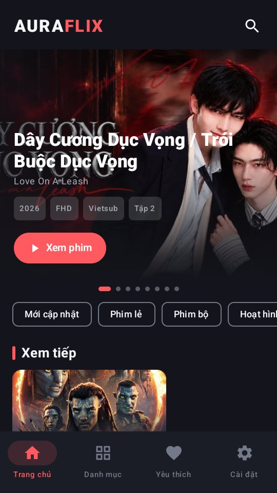
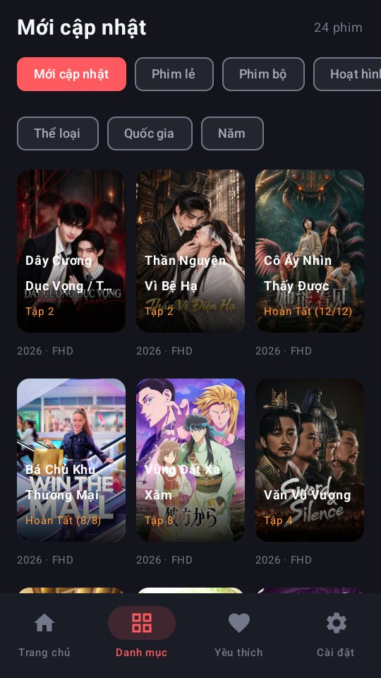
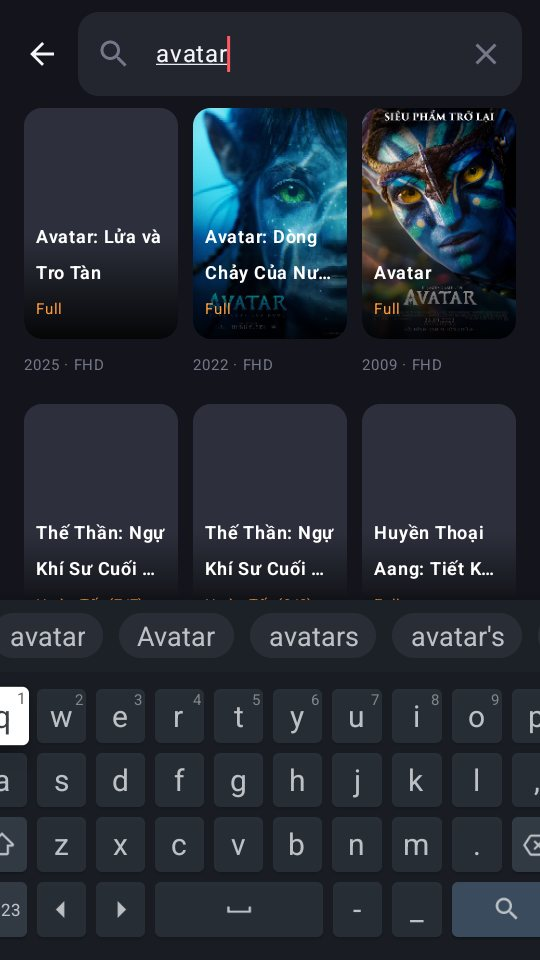
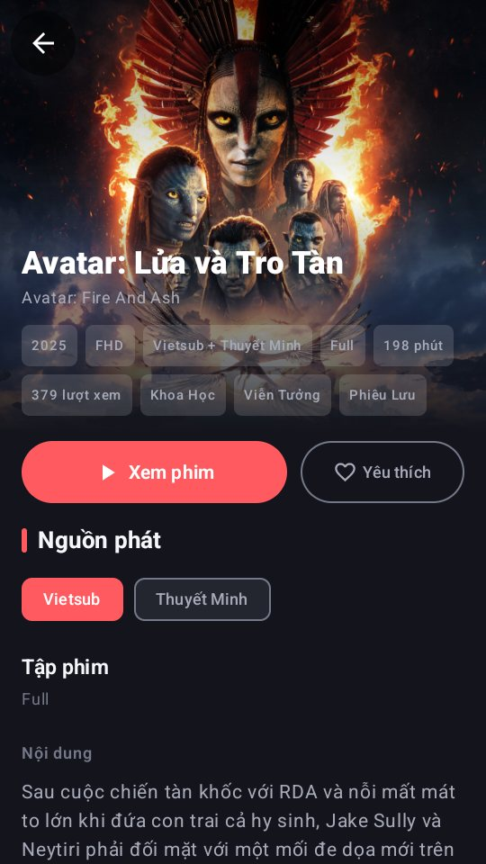
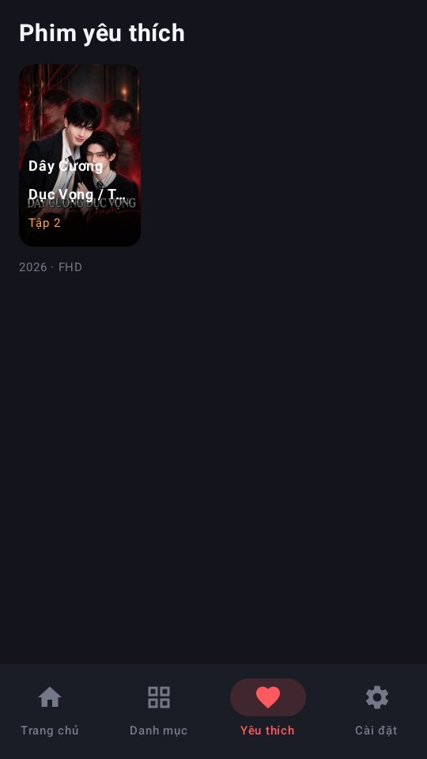
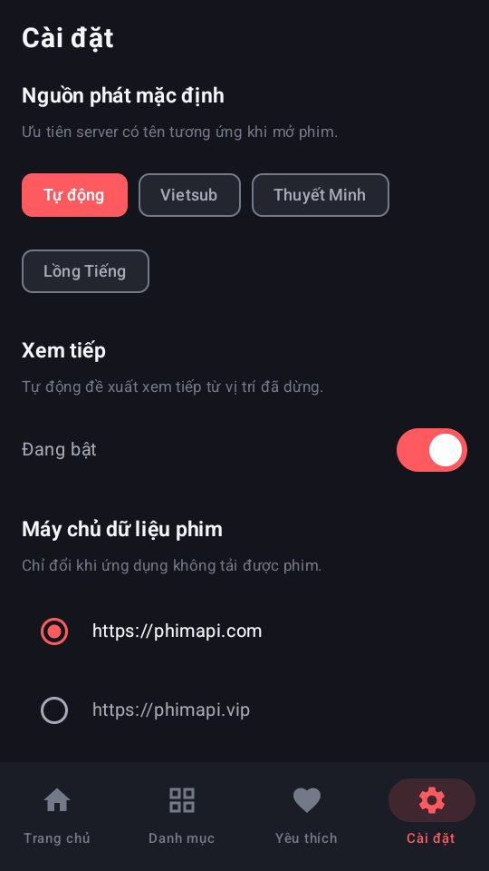

# AuraFlix Mobile — Ứng dụng xem phim cho điện thoại

Ứng dụng Android **cảm ứng** dùng chung nguồn dữ liệu và tầng xử lý với bản TV.
APK riêng, cài song song với bản TV (không ghi đè).

🌐 **Trang giới thiệu & tải APK:** <https://haokiet97.github.io/auraflix_mobile_release/>

| Hạng mục | Giá trị |
|---|---|
| Package | `com.auraflix.mobile` |
| Phiên bản | 1.1.0 (versionCode 5) |
| Module | `:mobile` |
| Kích thước APK release | ~3.1 MB |
| Yêu cầu | Android 5.0 (API 21) trở lên, màn hình cảm ứng |

## 0. Ảnh chụp (Android 34, 540×960)

| Trang chủ | Danh mục | Tìm kiếm |
|---|---|---|
|  |  |  |

| Chi tiết | Yêu thích | Cài đặt |
|---|---|---|
|  |  |  |


## 1. Kiến trúc

```
:shared   (Android library)
├── core/model      DTO phimapi.com
├── core/net        OkHttp + kotlinx.serialization
├── core/repo       MovieRepository, UserDataRepository (DataStore)
├── core/update     AppVersion, ReleaseNotes, UpdateManager (OTA)
├── core/cast       Điều khiển TV ↔ Mobile trong LAN (server, discovery, client, controller)
├── core/util       format thời gian, text
└── ui/*ViewModel   ViewModel dùng chung TV + Mobile

:app      (TV)      giao diện Compose for TV + remote
:mobile   (Mobile)  giao diện Material3 cảm ứng
```

- ViewModel và repository **chỉ tồn tại một bản** trong `:shared`, hai app chỉ khác lớp UI.
- Mobile dùng Material3 (touch) thay cho `androidx.tv:tv-material`.
- Không dùng DI framework, không Leanback.

## 2. Màn hình & tính năng

| Màn hình | Nội dung |
|---|---|
| Trang chủ | Banner phim mới tự chuyển, chip thể loại nhanh, hàng **Xem tiếp**, các hàng phim (LazyRow) |
| Danh mục | Grid 3 cột, lọc **Loại + Thể loại + Quốc gia + Năm** bằng bottom sheet, cuộn vô hạn |
| Tìm kiếm | `TextField` + bàn phím hệ thống, debounce 400 ms, lịch sử tìm kiếm trong phiên |
| Chi tiết | Backdrop lớn, poster/thông tin, nút **Phát / Xem tiếp**, yêu thích, chọn nguồn, sheet chọn tập, phim liên quan |
| Trình phát | ExoPlayer (Media3), tự xoay ngang, ẩn thanh hệ thống, chạm để hiện điều khiển, **double-tap trái/phải tua ±10 s**, **nhấn giữ để tua nhanh 2x**, **vuốt dọc nửa trái đổi độ sáng, nửa phải đổi âm lượng**, kéo seek bar, chọn tập/nguồn, tốc độ, tỉ lệ khung hình, tự chuyển tập sau 10 s |
| Yêu thích | Grid poster, lưu bằng DataStore |
| Cài đặt | Server mặc định, xem tiếp, domain API, **cập nhật OTA**, xoá lịch sử |
| Điều khiển TV | Ghép cặp với TV cùng Wi-Fi bằng PIN; nút **Phát trên TV** ở màn Chi tiết; thanh mini "Đang phát trên TV"; bộ điều khiển phát/tạm dừng, tua ±10 s, thanh tua, chuyển tập, dừng trên TV |

Điều hướng: **Bottom navigation** 4 tab (Trang chủ · Danh mục · Yêu thích · Cài đặt).
Chi tiết và trình phát là màn hình toàn màn hình.

## 3. Build

```powershell
$env:JAVA_HOME="C:\Users\<you>\AppData\Local\Programs\jdk17\jdk-17.0.21.1+2"
.\gradlew.bat :mobile:assembleDebug      # APK debug: com.auraflix.mobile.debug
.\gradlew.bat :mobile:assembleRelease    # APK release: mobile/build/outputs/apk/release/
.\gradlew.bat :app:assembleRelease       # bản TV vẫn build độc lập
.\gradlew.bat :app:testDebugUnitTest     # unit test dùng chung tầng dữ liệu
```

APK release ký bằng **debug keystore** giống bản TV để tiện cài trực tiếp.
Khi phát hành chính thức, tạo keystore riêng và cấu hình `signingConfigs` cho cả hai module.

## 4. Cài đặt

```bash
adb install -r mobile/build/outputs/apk/release/mobile-release.apk
```

APK phát hành đặt tại thư mục gốc: `AuraFlixMobile-1.1.0.apk` (3.13 MB)

```
SHA-256: 4E86D2279A36CC32F09A4D0C87C99F60F6D161519505308C457F6B63399EB025
```

Hoặc copy APK vào điện thoại và mở (bật *Cài đặt → Bảo mật → Nguồn không xác định*).

## 5. Kênh phát hành & OTA

Mobile dùng **kênh phát hành riêng**, không dùng chung repo release với TV
(vì `releases/latest` chỉ trả về một APK, và APK TV sẽ không cài đè được app Mobile).

```
Repo:     https://github.com/haokiet97/auraflix_mobile_release
API OTA:  https://api.github.com/repos/haokiet97/auraflix_mobile_release/releases/latest
Trang web: https://haokiet97.github.io/auraflix_mobile_release/
```

Quy trình phát hành đầy đủ (tăng version → build → tạo GitHub Release → cập nhật trang
giới thiệu/tài liệu → kiểm tra OTA → rollback) nằm trong
[`RELEASE_GUIDE_MOBILE.md`](RELEASE_GUIDE_MOBILE.md).

Nếu đổi repo, sửa `UpdateManager.MOBILE_RELEASE_URL` trong `:shared`.
OTA tải APK vào `cache/updates`, xác thực SHA-256 (GitHub cung cấp `digest`) rồi mở trình cài đặt.

## 6. Checklist kiểm thử trên điện thoại

- [ ] Mở app lần đầu: trang chủ tải banner + ≥ 5 hàng phim.
- [ ] Kéo ngang các hàng phim mượt, ảnh poster hiển thị.
- [ ] Danh mục: đổi loại, lọc thể loại/quốc gia/năm, cuộn tải thêm.
- [ ] Tìm kiếm bằng bàn phím hệ thống, nhấn Enter, mở phim từ kết quả.
- [ ] Chi tiết: phát phim, chọn tập, đổi nguồn, yêu thích/bỏ yêu thích.
- [ ] Trình phát: xoay ngang, chạm hiện/ẩn điều khiển, double-tap tua, kéo seek bar, đổi tốc độ.
- [ ] Vuốt dọc nửa trái tăng/giảm **độ sáng**; nửa phải tăng/giảm **âm lượng** (HUD hiện % ); rời player độ sáng khôi phục.
- [ ] Nhấn giữ màn hình để **tua nhanh 2x** (hiện nhãn 2x), nhả ra về đúng tốc độ đang chọn.
- [ ] Thoát giữa chừng rồi vào lại: **Xem tiếp** đúng vị trí.
- [ ] Xoay dọc/ngang khi ở trang chủ không crash, không mất state.
- [ ] Cài đặt: đổi server, xoá lịch sử, kiểm tra cập nhật.
- [ ] Điều khiển TV: TV bật *Cài đặt → Điều khiển bằng điện thoại* → điện thoại **Kết nối TV** →
      chọn TV → nhập PIN → **Phát trên TV** từ Chi tiết → thanh mini + bộ điều khiển phát/tua/chuyển tập
      ([chi tiết](CAST.md)).
- [ ] Mất mạng: hiện màn hình lỗi + nút **Thử lại**.

### Đã smoke test (emulator Android 34 x86, 540×960 @ 240dpi)

| Luồng | Kết quả |
|---|---|
| Trang chủ + banner + hàng phim + Xem tiếp | ✅ |
| Danh mục + lọc thể loại + tải thêm | ✅ |
| Tìm kiếm bằng bàn phím hệ thống, mở kết quả | ✅ |
| Chi tiết + chọn tập + yêu thích | ✅ |
| Trình phát HLS, tập 1/tập 2, sheet tập, tua, lưu tiến trình | ✅ |
| Thoát player → chi tiết → **Xem tiếp** đúng vị trí | ✅ |
| Yêu thích hiển thị lại sau khi mở tab | ✅ |
| Cài đặt + OTA với release `v1.0.0` thật (báo "bạn đang dùng bản mới nhất") | ✅ |
| Ghép cặp TV + thanh mini + bộ điều khiển (emulator TV + emulator mobile, chung NAT) | ✅ |
| Crash/ANR trong logcat | ✅ không có |

> Emulator dùng system image Android TV nên cửa sổ player bị letterbox khi ép landscape;
> trên điện thoại thật, player sẽ chiếm toàn màn hình ngang. Cần chạy lại checklist trên
> ít nhất một điện thoại thật trước khi phát hành rộng rãi.
>
> Bản **release APK (R8)** đã được cài trên emulator để kiểm tra OTA với release `v1.0.0` thật
> và không có crash/ANR.

### Thay đổi v1.0.1

- **Sửa lỗi màn hình tự tắt/khoá khi đang xem phim.** Trình phát trước đây chỉ bật
  `keepScreenOn` trên `ComposeView`; `PlayerView` của Media3 nằm đè lên với surface riêng nên
  khi video nhận focus, Window không còn giữ màn hình sáng. Nay `PlayerScreen` bật
  `FLAG_KEEP_SCREEN_ON` ở cấp cửa sổ và gỡ cờ khi rời trình phát.
- Bản vá: `AuraFlixMobile-1.0.1.apk` (versionCode 2).

### Thay đổi v1.0.2

- **Vuốt dọc khi xem phim để điều chỉnh nhanh:**
  - Nửa **trái** màn hình: vuốt lên tăng / xuống giảm **độ sáng**.
  - Nửa **phải** màn hình: vuốt lên tăng / xuống giảm **âm lượng** (âm lượng hệ thống).
- Hiện HUD nhỏ giữa màn hình với biểu tượng và % trong lúc vuốt.
- Độ sáng chỉ áp dụng cho màn hình xem phim và **tự khôi phục** khi thoát.
- Tap hiện/ẩn điều khiển và double-tap tua ±10 s vẫn hoạt động như cũ; gesture được xử lý
  gộp một lớp nên không xung đột với seek bar.
- Bản phát hành: `AuraFlixMobile-1.0.2.apk` (versionCode 3).

### Thay đổi v1.0.3

- **Nhấn giữ màn hình khi xem phim** để tạm phát ở **2x**; nhả tay về tốc độ đang chọn.
- Hiện nhãn `▶▶ 2x` ở phía trên khi đang tua nhanh.
- Không xung đột với các thao tác khác: di chuyển trước ngưỡng giữ (~350 ms) sẽ thành vuốt
  sáng/âm lượng; chạm ngắn vẫn là tap/double-tap như cũ.
- Bản phát hành: `AuraFlixMobile-1.0.3.apk` (versionCode 4).

### Thay đổi v1.1.0 — điều khiển TV

- **Ghép cặp với AuraFlix TV cùng Wi-Fi**: tự tìm TV bằng UDP broadcast (hoặc nhập IP tay),
  nhập PIN 6 số hiện trong *Cài đặt → Điều khiển bằng điện thoại* trên TV.
- **Phát trên TV**: nút mới ở màn Chi tiết gửi phim/tập/nguồn đang chọn sang TV và mở trình phát.
- **Thanh mini** "Đang phát trên TV" (poster, tập, tiến trình, phát/tạm dừng) hiện trên mọi tab.
- **Bộ điều khiển**: phát/tạm dừng, tua ±10 s, thanh tua, tập trước/tập tiếp, chọn tập, dừng trên TV.
- Sửa: điện thoại vừa mở app không còn hiện nhầm "TV chưa phát phim nào" khi TV đang chiếu.
- Bản phát hành: `AuraFlixMobile-1.1.0.apk` (versionCode 5) — cần TV **v1.2.0** trở lên.
- Chi tiết giao thức & bảo mật: [`CAST.md`](CAST.md).

## 7. Khác biệt so với bản TV

| Điểm | TV | Mobile |
|---|---|---|
| Điều khiển | D-pad / remote | Chạm + vuốt |
| Bố cục | 1920×1080 cố định | Thích ứng dọc, player xoay ngang |
| Tìm kiếm | Bàn phím ảo tự vẽ | Bàn phím hệ thống |
| Điều hướng | Thanh trên + focus | Bottom navigation |
| Tua nhanh | Giữ ◀/▶ tăng dần | Double-tap ±10 s + seek bar |
| OTA | `auraflix_tv_release` | `auraflix_mobile_release` |

## 8. Giới hạn hiện tại

- Chưa hỗ trợ PiP (picture-in-picture), tải offline.
- Cast chỉ chạy khi hai thiết bị cùng mạng LAN (không qua Internet); xem [`CAST.md`](CAST.md).
- Chưa có lịch sử tìm kiếm lưu vĩnh viễn (chỉ trong phiên).
- Chưa test trên điện thoại thật — mới smoke test trên emulator (xem mục 6).
